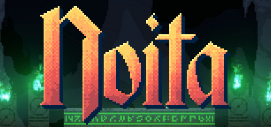

**Noita by Nolla Games (2020) is a magical roguelite where every pixel is simulated.**

---

## 📖 About

Noita by Nolla Games (2020) is a magical roguelite where every pixel is simulated. You are a witch descending through procedural biomes, crafting wands with combinatorial spell physics. The simulation means explosions, fire, and acid interact realistically — and will kill you in ways no other game can.

## ⚠️ Problems Without Trainer

| Problem | Status |
|---------|--------|
| Wand crafting relies on RNG seed luck to find game-breaking synergies | ✅ Solved |
| One-shot deaths from reflected spells or unexpected enemy projectiles | ✅ Solved |
| Gold income too low to afford shop items before punishing biomes | ✅ Solved |
| Polymorphed into weak creatures by enemy spells at critical moments | ✅ Solved |
| Holy Mountain peace broken by enemies eliminating safe upgrade windows | ✅ Solved |

## ✅ Solution

The **Noita Trainer** solves all these issues, giving you complete control so you can focus on enjoying the game.

## 🎯 Features

- Unlimited Resources / Currency
- God Mode / Invincibility
- Instant Skill & Ability Cooldown
- One-Hit Kill
- Freeze Timers
- Unlock All Items & Achievements
- Custom Speed Multiplier
- Infinite Stamina / Energy

## 🚀 Quick Start

1. **Disable Windows Defender** temporarily (trainer may trigger false positive)
2. Get the trainer from the button above
3. Launch Noita
4. Run the trainer as Administrator
5. Use the hotkeys to activate cheats in-game

## 💎 Free vs Pro

| Feature | Free | Pro |
|---------|------|-----|
| God Mode | ✅ | ✅ |
| Unlimited Resources | ✅ | ✅ |
| Advanced Cheats | ❌ | ✅ |
| Auto-Updates | ❌ | ✅ |
| Priority Support | ❌ | ✅ |

## 💻 Requirements

- Windows 10 / 11 (64-bit)
- Noita (any version)
- .NET Framework 4.8+
- DirectX 11+

## 🍎 macOS

## ⚖️ Legal

Educational and single-player use only.

---

